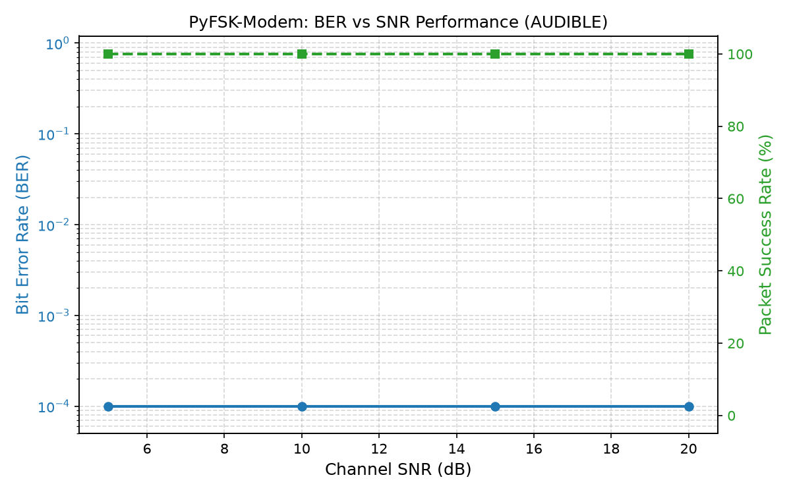
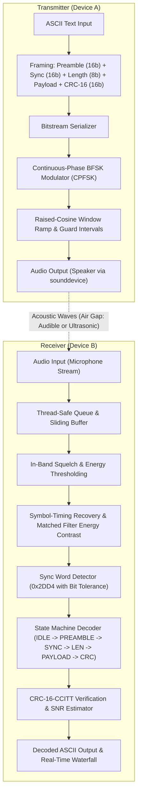

# PyFSK-Modem: Software-Defined Acoustic Air-Gap Modem

A software-defined acoustic modem written in Python that transmits ASCII text packets between isolated devices across a physical air gap using only speakers and microphones (audible and near-ultrasonic acoustic waves). No RF, Wi-Fi, Bluetooth, or specialized SDR hardware required.



---

## Architecture & Block Diagram



---

## Key Features

- **Dual Acoustic Modes**:
  - `AUDIBLE`: Mark = 1800 Hz, Space = 2200 Hz (robust against room reverberation, easily audible for debugging).
  - `ULTRASONIC`: Mark = 18500 Hz, Space = 19500 Hz (silent, near-ultrasonic transmission below standard 44.1/48 kHz Nyquist limit).
- **Continuous-Phase BFSK (CPFSK)**: Zero phase discontinuities across symbol transitions, drastically reducing out-of-band spectral splatter.
- **Envelope Shaping**: Raised-cosine windowing at burst boundaries with leading/trailing silence guards.
- **Robust Framing**: Alternating preamble (`1010...`), 16-bit sync word (`0x2DD4`), length byte, and CRC-16-CCITT error detection. Corrupted packets are rejected with detailed error reporting.
- **Symbol-Timing Recovery**: Fine sample-level offset optimization via mark/space energy contrast maximization.
- **Real-Time Streaming**: Low-latency non-blocking audio capture stream with buffer overflow protection.
- **Live Waterfall & Spectrum Visualizer**: Real-time spectral power display and spectrogram waterfall (`--visualize`).
- **Hardware-Agnostic Loopback Mode**: In-memory AWGN channel simulator to test BER vs. SNR performance without audio hardware.

---

## Packet Format

```
+------------------+-------------------+-----------------+-----------------------+--------------------+
| Preamble (16 b)  |  Sync Word (16 b) |   Length (8 b)  |   Payload (N Bytes)   |  CRC-16-CCITT (16b)|
| 1010101010101010 |      0x2DD4       | N (0 - 255 B)   |      ASCII Data       | Poly 0x1021        |
+------------------+-------------------+-----------------+-----------------------+--------------------+
```

- **Preamble**: 16 alternating bits (`1010101010101010`) used by the receiver to establish squelch activation and lock symbol timing.
- **Sync Word**: `0x2DD4` (`0b0010110111010100`), framed to unambiguously identify byte alignment.
- **Length**: 1 byte specifying the number of payload bytes (up to 255 bytes).
- **Payload**: ASCII text bytes.
- **CRC-16-CCITT**: Calculated over `[Length] + [Payload]` (polynomial `0x1021`, initial value `0xFFFF`).

---

## Installation

### Prerequisites
- Python 3.10 or newer
- System audio drivers (ALSA on Linux, CoreAudio on macOS, WASAPI on Windows)
- PortAudio library (installed automatically via `sounddevice` wheels on most platforms)

### Setup
```bash
# Clone or navigate to the repository
cd "PyFSK-Modem"

# Create and activate virtual environment
python3 -m venv .venv
source .venv/bin/activate

# Install required dependencies
pip install -r requirements.txt
```

---

## CLI Usage

The package provides four main subcommands: `devices`, `send`, `listen`, and `loopback`.

### 1. List Available Audio Devices
Inspect all connected microphones and speakers:
```bash
python -m pyfsk_modem devices
```

### 2. Transmit Message (TX)
Transmit text over your speaker:
```bash
# Audible transmission at default 100 baud
python -m pyfsk_modem send "Hello Air Gap!"

# Silent ultrasonic transmission at 120 baud
python -m pyfsk_modem send "Confidential Message" --mode ultrasonic --baud 120

# Specify audio output device and lower amplitude
python -m pyfsk_modem send "Low Volume" --device 0 --amplitude 0.5
```

### 3. Receive / Listen (RX)
Continuously listen on your microphone and decode incoming packets:
```bash
# Listen in audible mode
python -m pyfsk_modem listen

# Listen in ultrasonic mode with real-time spectrum and waterfall visualizer
python -m pyfsk_modem listen --mode ultrasonic --visualize

# Tune squelch threshold for noisy environments (e.g., 3.5x background noise)
python -m pyfsk_modem listen --squelch 3.5
```

### 4. Software Loopback & BER Testing
Simulate transmission through an Additive White Gaussian Noise (AWGN) channel in memory without audio hardware:
```bash
# Test loopback at 10 dB SNR
python -m pyfsk_modem loopback "Hello Simulation" --snr 10

# Test ultrasonic loopback at 5 dB SNR
python -m pyfsk_modem loopback "Ultrasonic Test" --mode ultrasonic --snr 5

# Run statistical multi-SNR sweep and generate BER vs SNR plot
python -m pyfsk_modem loopback "Benchmark Payload" --sweep --trials 5 --plot-file ber_vs_snr.png
```

---

## Two-Device Air-Gap Demo Guide

To establish an acoustic air gap link between two laptops or computers (Device A and Device B):

### Step 1: Prepare Device B (Receiver)
On the receiving computer, launch the listener:
```bash
python -m pyfsk_modem listen --mode audible --baud 100
```
*(Optionally add `--visualize` to watch the incoming signal appear on the live waterfall!)*

### Step 2: Prepare Device A (Transmitter)
Position the speaker of Device A toward the microphone of Device B (approx. 0.5 to 2 meters). Run:
```bash
python -m pyfsk_modem send "Hello from Device A across the air gap!" --mode audible --baud 100
```

### Step 3: Verification
On Device B, you will immediately see:
```text
[2026-11-20 20:45:00] [CRC OK] SNR:  38.2 dB | Len: 42 B | Msg: 'Hello from Device A across the air gap!' (CRC-16 OK)
```

---

## Acoustic Channel Tuning Tips

1. **Volume & Gain Calibration**:
   - Set speaker output volume between **50% and 70%**. Setting volume to 100% often overdrives laptop micro-speakers, causing severe non-linear clipping distortion that degrades FSK tone orthogonality.
   - Adjust microphone input gain in OS sound settings to avoid clipping (waveform levels should peak around $-6\text{ dBFS}$ to $-3\text{ dBFS}$).
2. **Distance & Line-of-Sight**:
   - Acoustic sound pressure obeys the inverse-square law ($1/r^2$). For reliable 100 baud communication, maintain 0.5 to 2.5 meters distance.
   - Ensure a direct line of sight between the speaker grille and microphone aperture.
3. **Ultrasonic Mode Considerations**:
   - `ULTRASONIC` mode uses $18.5\text{ kHz}$ (Mark) and $19.5\text{ kHz}$ (Space).
   - Standard audio hardware sampled at $44.1\text{ kHz}$ or $48\text{ kHz}$ has a Nyquist limit of $22.05\text{ kHz}$ or $24\text{ kHz}$, which accommodates these frequencies.
   - **Hardware roll-off**: Many laptop speakers and low-cost built-in webcams sharply attenuate frequencies above $16\text{ kHz}$. If packets fail to detect in ultrasonic mode, test with external headphones/microphones or switch to `AUDIBLE` mode.
   - **Atmospheric absorption**: High acoustic frequencies ($>18\text{ kHz}$) attenuate much faster over air distance than audible frequencies. Keep devices within 1 meter when operating ultrasonically.
4. **Baud Rate vs. Room Reverberation**:
   - In enclosed rooms, walls and furniture reflect acoustic waves, creating multipath echoes with a delay spread of $5\text{ ms}$ to $30\text{ ms}$.
   - At **100 baud** (symbol duration $10\text{ ms}$), multipath interference is minimal because the symbol duration comfortably exceeds the dominant echo path.
   - For higher baud rates ($>200\text{ baud}$), symbol duration drops ($<5\text{ ms}$), causing consecutive symbols to overlap in the presence of echoes. Keep baud rate between **50 and 150** for optimal acoustic air-gap reliability.

---

## Known Limitations

- **Half-Duplex**: The protocol is simplex / half-duplex. If a device transmits and listens simultaneously on the same frequency band, local acoustic echo feedback will swamp remote signals.
- **Multipath / Room Echoes**: Highly reverberant environments (e.g., bare tiled rooms) may cause inter-symbol interference at baud rates exceeding 200 baud.
- **Ambient Noise Spikes**: Sharp acoustic impulses (keys jingling, loud typing, door slams) can introduce wideband noise spikes. CRC-16 ensures damaged packets are safely identified and rejected.

---

## Running Automated Tests

Run the full pytest suite (25 tests covering framing, CRC-16, continuous-phase BFSK modulator frequency peaks, demodulator timing recovery, hardware error handling, and AWGN noise tolerance):

```bash
pytest -v
```
